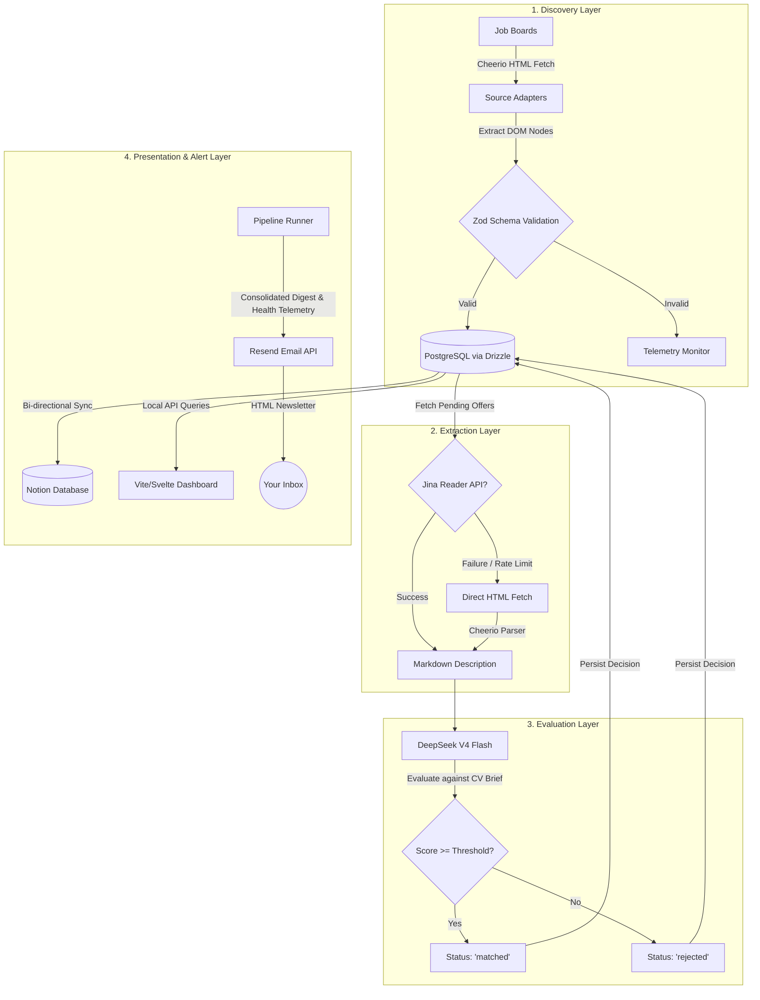

# JobETL

JobETL automates the ingestion, filtering, and scoring of software engineering job postings against candidate profile briefs.

The pipeline discovers listings from supported job boards, extracts full offer descriptions (using Jina Reader with an automated Cheerio HTML-to-text fallback), scores each role using DeepSeek V4, and stores deduplicated results in PostgreSQL via **Drizzle ORM**. Alerts are dispatched through Resend as a unified digest with real-time scraper health telemetry, with optional bi-directional synchronization to Notion.

## The Idea In 30 Seconds

- Select job boards and query filters.
- Define one or more profile match briefs (`cv.md`, `cv-ai.md`, ...).
- Execute the pipeline across all enabled profiles or target a specific lane with `--profile`.
- Review candidates exceeding the matching threshold in the terminal, via email digests, or through the web dashboard.

## Stack

- **Runtime:** Node.js + TypeScript
- **Job Sources:** `justjoin.it`, `nofluffjobs`, `bulldogjob`, `pracuj.pl`, `thesmartjobs.com`
- **Full-Offer Extraction:** Jina Reader API (with automated local Cheerio HTML-to-text fallback)
- **AI Matching:** DeepSeek V4 (`deepseek-v4-flash`) via the Vercel AI SDK
- **Storage:** Containerized PostgreSQL managed with **Drizzle ORM**
- **Dashboard:** Svelte 5 + Vite (behind an authenticated Node.js API with Argon2 verification)
- **Alerts:** Resend Email API (consolidated multi-profile digests + scraper health telemetry)
- **Automation:** GitHub Actions (CI & CD) + host-level cron scheduling

---

## Architecture & Data Flow

The pipeline uses a decoupled, four-tier architecture designed for speed, resilience, and minimal operating costs:

### 1. Discovery & Validation (Cheerio + Zod)
- **Cheerio** downloads and parses HTML search result pages rapidly without the memory overhead of headless browsers.
- **Zod** acts as a structural firewall (`JobListingSchema`). Job boards frequently alter DOM selectors; any missing field (title, company, URL) is trapped immediately and logged to the Telemetry monitor rather than propagating corrupted records into storage.

### 2. Deep Extraction (Jina Reader & Cheerio Fallback)
- **Jina Reader API** (`https://r.jina.ai/`) acts as the primary extractor, resolving target pages, stripping navbars, modals, and tracking scripts, and returning clean Markdown.
- **Cheerio Fallback:** If Jina Reader is rate-limited (HTTP 429), out of credits (HTTP 402), or unreachable, the pipeline automatically fetches raw HTML directly and strips markup locally. This ensures continuous, zero-cost operational resilience.

### 3. Intelligence & Scoring (DeepSeek V4)
- **DeepSeek V4 Flash** evaluates extracted markdown descriptions against profile CV briefs (`cv.md`, `cv-ai.md`, ...).
- DeepSeek provides high reasoning accuracy at minimal token cost, allowing high-throughput candidate evaluation without excessive API overhead.

### 4. Storage & State Management (PostgreSQL + Drizzle ORM)
- **PostgreSQL** runs in a Docker container with persistent named volumes to maintain data across container lifecycles. Deduplication is handled at the application and schema layer by checking job URLs and source IDs against existing records, preventing duplicate processing across subsequent runs.
- **Drizzle ORM** enforces compile-time TypeScript schema safety across queries and migrations, significantly reducing SQL type mismatches and syntax errors.

---

## Pipeline Flow



---

## API Keys & Environment Variables

Required for core pipeline execution:
- `DEEPSEEK_API_KEY`: Authentication key for DeepSeek V4 matching.
- `DATABASE_URL`: PostgreSQL connection string (must use loopback in local dev).

Optional:
- `JINA_API_KEY`: Bearer token for Jina Reader. If omitted or exhausted, the pipeline falls back to Jina's keyless tier and then to the local Cheerio extractor.
- `RESEND_API_KEY`, `SENDER_EMAIL`, `RECIPIENT_EMAIL`: When configured, dispatches a consolidated HTML digest across all enabled profiles. Features daily heartbeat delivery (even on 0 matches) with an embedded Scraper Health Monitor widget.
- `NOTION_TOKEN`, `NOTION_DATABASE_ID`: Required only if using Notion bi-directional synchronization.

---

## Quick Setup

1. Install dependencies:
   ```bash
   npm install
   ```

2. Provision environment configuration and CV briefs:
   ```bash
   cp .env.example .env
   cp cv.example.md cv.md
   cp cv-ai.example.md cv-ai.md
   ```

   > [!IMPORTANT]
   > Candidate brief files (`cv.md`, `cv-ai.md`) contain personal PII and are strictly excluded via `.gitignore`. When deploying to production servers, manually provision these files via secure transport (`scp`), or ensure unprovisioned profiles have `enabled: false` in [`src/core/config.ts`](src/core/config.ts) to prevent `ENOENT` pipeline halts.

3. Configure `.env` with strong credentials. Never reuse default passwords:
   ```env
   # Bind strictly to 127.0.0.1 to avoid exposing the database across external interfaces
   DATABASE_URL=postgres://jobetl_user:<your_strong_password>@127.0.0.1:5432/jobetl
   ```

4. Configure profiles in [`src/core/config.ts`](src/core/config.ts): configure `enabled`, `resumeMarkdownPath`, `matchThreshold`, `emailSubjectPrefix`, and source query parameters.

5. Start the local database container and apply Drizzle migrations:
   ```bash
   npm run db:start
   npm run db:migrate
   ```

---

## Execution Commands

### Scraper Health Smoke Testing
Execute non-destructive HTTP and DOM parsing validation across all configured job boards without LLM scoring or database mutations:
```bash
npm run check:sources
```

### Full Ingestion Pipeline
Run all enabled profiles sequentially (`software` is enabled by default; `ai` executes only when `ai.enabled` is toggled to `true` in configuration):
```bash
npm run dev
```

Target a specific profile and/or source adapter:
```bash
npm run dev -- --profile software
npm run dev -- --profile software --source justjoinit
npm run dev -- --source nofluffjobs
```

Review top matches directly in the terminal:
```bash
npm run report
```

### Web Dashboard
The dashboard provides interactive metrics (*Total Evaluated*, *Matched*, *Applied*, *Not Interested*, *Average Score*), status segment filtering, and a drawer view for offer inspection.

1. Generate the Argon2 password hash:
   ```bash
   npm run hash:password
   ```
   Save the resulting string into `DASHBOARD_PASSWORD_HASH` in `.env`. The API server refuses to boot if this hash is missing.

2. Launch API backend and Vite UI concurrently:
   ```bash
   npm run dashboard   # API on :3001 + Vite UI on :3000
   ```

Optional Notion synchronization:
```bash
npm run import:notion
npm run sync:notion
```

---

## Production Deployment & Operational Security

In production, JobETL is deployed on a Linux cloud instance (e.g. AWS EC2) with automated CI/CD:

- **Hosting & Isolation:** Ubuntu Linux. The Node.js application binds strictly to loopback (`127.0.0.1:3001`) and is supervised by **PM2** (`ecosystem.config.cjs`).
- **TLS & Reverse Proxy:** Nginx terminates TLS, enforces HTTP security headers (HSTS, CSP, X-Frame-Options DENY), serves static bundles (`ui/dist`), and proxies `/api/*` to Node.js with IP-based rate limiting on `/api/login`.
- **Database Security:** PostgreSQL runs in Docker. Port 5432 must never be bound to `0.0.0.0` or opened in cloud security groups.
- **Scheduling (Cron):** Executed twice daily at 11:00 and 19:00 host local time via `crontab`. Output logs are captured in `logs/crawler.log`:
  ```text
  0 11,19 * * * . $HOME/.bashrc && cd /home/ubuntu/jobetl && npm run dev >> /home/ubuntu/jobetl/logs/crawler.log 2>&1
  ```
  **Log Rotation:** Configure `/etc/logrotate.d/jobetl` to prevent disk exhaustion:
  ```text
  /home/ubuntu/jobetl/logs/crawler.log {
      daily
      rotate 7
      compress
      delaycompress
      missingok
      notifempty
      copytruncate
  }
  ```
- **Continuous Deployment:** Managed via [`.github/workflows/deploy.yml`](.github/workflows/deploy.yml). Pushes to `master` trigger SSH deployment, run migrations, compile UI/backend bundles, and execute zero-downtime PM2 reloads. Detailed infrastructure hardening is documented in [`deployment.md`](deployment.md).

---

## Verification & Code Quality

Before pushing commits, run the repository's mandatory pre-flight check:

```bash
npm run check
```

This single command atomically runs:
- Prettier code style validation (`npm run format:check`)
- ESLint static analysis (`npm run lint`)
- TypeScript production build (`npm run build`)
- Vitest unit & integration test suites (`npm test`)
